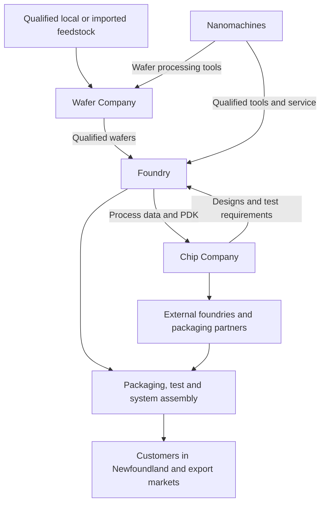

# Newfoundland Computers

## An open plan to build a semiconductor and computer industry in Newfoundland

**Vision:** By 2056, Newfoundland should have the people, businesses, infrastructure, and partnerships to design computers and manufacture selected semiconductor products locally, including memory where a technically and commercially credible opportunity exists.

This repository develops four proposed companies: **Newfoundland Wafer Company**, **Newfoundland Nanomachines**, **Newfoundland Chip Company**, and **Newfoundland Foundry**. It is an invitation for experienced founders, engineers, business developers, researchers, workers, communities, and investors to improve these plans and put viable parts into practice.

**Anyone may use the original plans to start a business, raise financing, make products, or adapt the approach. No fee, equity stake, or permission from the project initiator is required.** The repository's original material is offered under the [MIT License](LICENSE); retain the required notices when copying it. See [licensing and implementation rights](docs/licensing.md) for the boundary between these plans and third-party patents, designs, data, and industrial know-how.

**Status:** Research-backed concept, version 0.1, 21 October 2026. These are proposed company names, not claims of incorporation or existing operations. No site, mineral resource, customer, supplier agreement, financing, or partnership has been secured by this repository. Budgets are original screening estimates in constant 2026 Canadian dollars, not quotations, forecasts, or investment commitments.

## Start here

| Reader | Useful starting point |
| --- | --- |
| Someone who wants to lead a business | The four [company plans](#four-companies), then the [first 90 days](docs/first-90-days.md) |
| Semiconductor or industrial expert | [System architecture](docs/architecture.md), [assumptions](research/assumptions.md), and [risk register](docs/risk-register.md) |
| Investor or public-sector reviewer | [Capital model](finance/README.md), [roadmap and decision gates](docs/roadmap.md), and [local feasibility](docs/local-feasibility.md) |
| Contributor looking for a concrete task | [Initial backlog](docs/backlog.md) and [contribution guide](CONTRIBUTING.md) |
| Someone who wants to understand the RAM goal | [Path from assembled computers to locally fabricated memory](docs/ram-and-cpu-path.md) |

## Four companies

The businesses should be able to sell outside Newfoundland and buy from qualified suppliers elsewhere. None should need all three of the other companies to exist before it can earn revenue.

| Proposed company | First business to validate | Initial financing envelope | First paying customer target | Longer-term manufacturing role |
| --- | --- | ---: | --- | --- |
| [Newfoundland Wafer Company](companies/01-wafer-company.md) | Qualified wafer sourcing, inspection coordination, traceability, and customer service; investigate local quartz separately | C$2–5M for 24 months | 6–18 months after funding | Wafer finishing, crystal growth, and potentially local silicon feedstock |
| [Newfoundland Nanomachines](companies/02-nanomachines.md) | Vacuum equipment service, controls upgrades, and selected laboratory equipment | C$2–5M for 18–24 months | 6–12 months after funding | Qualified deposition and other specialty tools; partner-led lithography development only if justified |
| [Newfoundland Chip Company](companies/03-chip-company.md) | FPGA, chip design, verification, and customer-funded ASIC engineering | C$1.5–4M for 18–24 months | 6–12 months after funding | Proprietary or open chip products, CPU designs, and suitable memory products using qualified manufacturing partners |
| [Newfoundland Foundry](companies/04-foundry.md) | Test, metrology, board/module integration, and outsourced packaging coordination | C$5–15M for 24 months | 12–24 months after funding | Pilot fabrication, then a selected specialty semiconductor process if demand and financing support it |

**Combined initial envelopes: C$10.5–29M.** This arithmetic describes four staffed startup scopes; it is not a minimum entry fee and is not a budget for four operating factories. A founder can begin interviews and planning with much less. The proposed shared 6–12 month feasibility program is a separate C$0.25–0.75M envelope. Launch only the businesses that pass their customer and capability gates.

The model includes equipment/facility investment, operating runway, working capital, and contingency. It assumes no grants or operating revenue reduce the initial raise. First revenue is not profitability, and service revenue is not proof of qualified wafer or chip production. [See the definitions and calculations.](finance/README.md)

## How the industry fits together



Packaging, test, boards, firmware, and computer assembly sit within the Foundry and Chip Company plans or qualified outside partners. The diagram shows possible future commercial relationships, not existing supply contracts. Each local supplier must pass the same technical and economic acceptance tests as an outside supplier.

## Five decisions that make the plan practical

1. **Start with customers and people.** Validate a paid design engagement, a service contract, or a repeatable material order before purchasing a major production line.
2. **Separate local manufacturing from total self-sufficiency.** Imported tooling, gases, wafers, IP, packaging, or components may remain part of a successful Newfoundland industry. Track local value added honestly.
3. **Treat Grey River quartz as a question to test.** A quartz-bearing occurrence is not a qualified electronic-grade feedstock or an economic reserve. Independent geology, rights verification, representative sampling, impurity analysis, processing trials, and delivered-cost comparisons come first. [Wafer plan and evidence](companies/01-wafer-company.md).
4. **Make the memory target specific.** Assembling RAM modules, designing SRAM on a chip, making standalone SRAM, and manufacturing advanced DRAM are different capabilities. A mature logic process does not automatically become a competitive DRAM process. [Memory pathway](docs/ram-and-cpu-path.md).
5. **Release large capital only after evidence.** Process transfer, customer qualification, experienced operators, utility capacity, environmental approvals, and enough recurring demand must precede a commercial fab commitment. [Decision gates](docs/roadmap.md).

## Thirty-year direction

| Horizon | Intended capabilities | Evidence needed before expansion |
| --- | --- | --- |
| 2026–2028 | Build the open plan, recruit experienced leaders, establish customer requirements, test the mineral premise, and launch selected service/design businesses | Paid discovery or engineering work; verified facility access; explicit stop decisions where evidence fails |
| 2028–2031 | Repeat service revenue; FPGA products and externally fabricated chips; test and module assembly; initial qualified tool or wafer services | Repeat orders, measured margins, customer acceptance, reliable delivery |
| 2031–2036 | Selected wafer finishing or tool products; a specialized pilot process; a practical CPU/control product | Repeatable yields, process ownership or licenses, external customers, independent engineering review |
| 2036–2046 | A possible specialty fab or crystal-growth expansion; local packaging and test capability | Financeable offtake, firm utility service, transferable process, trained operations team, qualified products |
| 2046–2056 | Durable local computer and semiconductor production; evaluate a dedicated memory manufacturing partnership if justified | Competitive cost and yield against the technology and market of that time |

These are review windows, not promised completion dates. A strong design, test, equipment, and specialty materials cluster is valuable even if local DRAM production never becomes economic. The project should report that outcome accurately rather than redefine module assembly as chip fabrication.

## How much could the larger ambitions cost?

Original screening envelopes in 2026 CAD suggest **C$15–50M** for a selected wafer finishing/reclaim operation; **C$100–500M** for a more substantial crystal-growth/wafer expansion; **C$1–5B+** for an integrated mine-to-electronic-silicon-and-wafer program; **C$50–200M** for a limited fabrication pilot; and **C$1–3B** for a selected small specialty 150/200 mm fab. A partner-led advanced DRAM project is a separate **C$15–40B+ scenario**, not part of the funded base case. These scopes overlap and must not be added into a 30-year total.

For scale, NIST describes Polar's **US$525M** project as expansion and modernization of an existing mature-node plant; NXP's 2024 announcement described a **US$7.8B** new 300 mm mixed-signal/analog/power fab. Neither is a quotation for Newfoundland. [Polar benchmark](https://www.nist.gov/chips/polar-semiconductor-minnesota-bloomington) · [NXP benchmark](https://www.nxp.com/company/about-nxp/newsroom/NW-VSMC). The [company plans](#four-companies) explain scope and exclusions.

## What exists in this repository

| Location | Purpose |
| --- | --- |
| `companies/` | Four business plans with products, customers, staffing, capital, timelines, and investment gates |
| `docs/` | Architecture, roadmap, local due diligence, memory pathway, governance, risks, publication guide, and work backlog |
| `finance/` | Editable JSON assumptions and an explanatory capital model |
| `research/` | Source register, specialist evidence notes, and assumptions needing validation |
| `templates/` | Customer discovery, source records, decisions, and company-plan templates |
| `.github/` | Issue and pull-request templates for contributions |
| `scripts/capital_model.py` | Standard-library Python calculator for startup envelopes and inflation scenarios |

Run the initial financing calculation with Python 3:

```bash
python3 scripts/capital_model.py
```

For a hypothetical future price-level sensitivity, not a forecast:

```bash
python3 scripts/capital_model.py --year 2056 --inflation 0.025
```

## Help turn a proposal into an implementable plan

The most useful contributions now are customer evidence, corrections from experienced semiconductor operators, geological and analytical evidence, supplier quotations with publication permission, and founders willing to own a specific workstream. Improving the plan does not oblige anyone to start a company or contribute capital.

Read [CONTRIBUTING.md](CONTRIBUTING.md), choose a task from the [backlog](docs/backlog.md), and submit a focused change with evidence. See [publishing](docs/publishing.md) for setting up a new GitHub home from this starter.

**Project principle:** Make the next step small enough to test and the long-term ambition clear enough to guide it.
